# SYN Mirror

Two computers at two homes cannot connect to each other directly: each sits behind a NAT, its home router, and a NAT lets
nothing in that its own computer did not ask for. SYN Mirror connects them through a **meeting point** both can reach: an
OpenWrt router or any Linux computer. The meeting point joins their two connections once, and from then on passes the traffic
the way a router passes a forwarded port: in the kernel, with no program in between.

What a relay server or a VPN does for two computers behind NAT, with the load of a forwarded port. Both computers only dial out,
as any program does; SYN Mirror makes their two dialings one connection. RemoteDesk takes it for its way ③.

Not every meeting point needs an address that never changes: one whose address the provider changes writes it into a
**record** kept by another, of a fixed address, and the server reads it there by itself. Nor does the server get a new port at
each start, when it is not to: a **fixed port** is always the same, for one key. Both need nothing outside SYN Mirror: no DNS,
no service of anyone else.

**Nothing is copied.** A relay server receives every byte into a program and sends it again; a VPN encrypts and decrypts every
byte. SYN Mirror does neither: once the two connections meet, the meeting point does for them exactly what a router does for a
forwarded port - the kernel rewrites the addresses of each packet as it passes, and that is all. No program reads the data, no
buffer holds it, no byte goes up to a program and down again. So the meeting point costs what a forwarded port costs: a record
of a few hundred bytes per connection in the table of the kernel, and the forwarding a router does anyway, at its full speed. A
small home router that forwards ports well serves as many meetings as it would serve forwarded ports.

| | Needs a forwarded port at the home of the server | The traffic passes through a program | Load on the middle |
|:--|:--|:--|:--|
| Port forwarding | yes | no | none |
| A relay server (TURN and the like) | no | yes: every byte is received and sent again | high: CPU and memory for every byte |
| A VPN | no | yes: every byte is encrypted and decrypted | high: CPU for every byte |
| **SYN Mirror** | **no** | **no: the kernel forwards it, nothing copied** | **as for a forwarded port** |


| | The server | The client |
|:--|:--|:--|
| What it is | The computer with the service: RemoteDesk, Remote Desktop of Windows, SSH, a web server | The computer with the program that connects: the page of RemoteDesk, Remote Desktop Connection, ssh, a browser |
| What it does | Asks the meeting point for a port, opens it, and waits there | Connects to that port, as to any address |
| What it needs | The password of the meeting point; a few lines of code, or the script of SYN Mirror, or RemoteDesk | Only the line: the meeting point and the port. Nothing installed |

## What it does

- **Two NATs, no forwarded port.** The server waits behind its NAT, the client dials it from behind its own; they meet at a port
  of the meeting point, and get one TCP connection.
- **No program in the traffic, nothing copied.** After the meeting the kernel rewrites the addresses, as for a forwarded port:
  one record per connection, the data never read nor held by a program. The speed is the speed of the router forwarding, its
  load the load of a forwarded port: a weak router carries many connections at once.
- **Small.** A table of nftables rules, and one small script that answers the requests for a port: ucode on OpenWrt, about
  1.5 MB of memory, perl on a Linux computer.
- **Many at once.** As many servers wait at once as there are ports of meeting: 9999 by default.
- **A password, and guessers stopped.** 16 characters get and open a port; after 5 wrong tries an address is blocked for 10
  minutes, and a wrong one gets no answer at all.
- **Guessers of Remote Desktop and SSH stopped too.** A password tried and refused is a short connection: an address with more
  than 5 of them at a port is blocked there, in the kernel. A setting turns it off.
- **Fixed ports.** A port set aside for one key of 16 characters: the server knocks the key at it and waits, asks nothing; the
  client's line is the same at every start of the server, `router.example.org:41000`.
- **A meeting point whose address changes.** It writes its address into a record of a meeting point of a fixed address, every
  20 seconds and at once when it changes; the server reads it there, with a key of its own, and follows it to the new address,
  its port kept. No DNS, no service of anyone else: SYN Mirror and SYN Mirror.
- **A page in LuCI.** The lines for the servers, each copied with one button; who is connected, who waits, who is blocked, the
  records and the reports, the tries of the last 10 minutes; the settings; Uninstall.
- **A command on a Linux computer.** `sudo syn-mirror`: the same as the page, in the console - the lines, what happens, the
  fixed ports, the records, the reports, a new password.
- **For any program.** Only the server needs a few lines for it; the client dials as it always does.

| Section | |
|:--|:--|
| [Quick start](#quick-start) | Install, the password, uninstall |
| [Words used here](#words-used-here) | NAT, the server and the client, meeting point, ports, knock, hold, keys, records |
| [How it works](#how-it-works) | The meeting step by step, with pictures |
| [The lines](#the-lines) | What the server gets, part by part |
| [Fixed ports](#fixed-ports) | The same port at every start, for one key |
| [A meeting point whose address changes](#a-meeting-point-whose-address-changes) | Records and reports: the server finds it at its new address |
| [Install](#install) | On an OpenWrt router, on a Linux computer |
| [Update](#update) | The installer of the new release, the settings kept |
| [The page in LuCI](#the-page-in-luci) | What the page shows and does |
| [The command syn-mirror](#the-command-syn-mirror) | The same on a Linux computer, in the console |
| [Settings](#settings) | Password, ports, times, the block of guessers, fixed ports, records, reports |
| [Uninstall](#uninstall) | Everything erased, the settings too |
| [Any port of the server](#any-port-of-the-server) | Remote Desktop, SSH, VNC, a web server, any port: one script on the server, the program of that service on the client |
| [With RemoteDesk](#with-remotedesk), [In your own program](#in-your-own-program) | The server |
| [Safety](#safety), [When something goes wrong](#when-something-goes-wrong), [Limits](#limits) | |
| [Folders](#folders) | What is where; the pictures of this page |

## Quick start

The meeting point is either of two, with a public address or the range of ports forwarded to it:

| | An OpenWrt router | A Linux computer: Debian, Ubuntu, Fedora, Arch and others |
|:--|:--|:--|
| **1. Install** | Download the installer of one file into `/tmp` of the router and run it there: see [Install](#on-an-openwrt-router) | Download the installer of one file and run it with `sudo`: see [Install](#on-a-linux-computer-or-server) |
| **2. The password** | The installer prints it. Later: the web interface of the router, **Services > SYN Mirror**, with the settings and what happens now: who is connected, who waits, who is blocked | The installer prints it. Later: `sudo syn-mirror lines`, and `sudo syn-mirror` for what happens now |
| **3. The server** | Gets one line with everything it needs: **Copy the meeting point** beside it, on the same page | Gets one line with everything it needs: `sudo syn-mirror lines` prints it |
| **4. Uninstall** | **Uninstall SYN Mirror** at the bottom of the same page | `sudo sh syn-mirror-linux.sh remove` |

The line is the password, `@`, the public address or a name in DNS, `:`, the port of requests: `Tr7kQ2xZp4Lm9sWd@203.0.113.7:40000`.
Nothing else is to be given or typed. In RemoteDesk it is pasted where the program asks for the meeting point, or given to
`rdp-host --meet`. A fixed port and a meeting point whose address changes have lines of their own: see [The lines](#the-lines).

## Words used here

| Word | What it means | Example |
|:--|:--|:--|
| **NAT** | A device that hides the computers of a home behind one address. It lets in only answers to what they sent out | A home Wi-Fi router |
| **The server** | The computer with the service. It asks for a port of meeting, opens it, and waits there for the client | The remote computer of RemoteDesk; a computer with Remote Desktop or SSH |
| **The client** | The computer that connects to the port the server opened: it only dials | A browser with the page of RemoteDesk; Remote Desktop Connection |
| **Meeting point** | The router or computer with SYN Mirror, reachable by both | An OpenWrt router with a public address, or a rented Linux computer, a VPS |
| **Port of requests** | The first port of the range. The server asks it for a port of meeting | 40000 |
| **Port of meeting** | A port the meeting point gives the server, one nobody else holds; the server and the client both dial it | 41933 |
| **Password** | 16 letters and digits of the meeting point: whoever knows them can get and open a port of meeting | `Tr7kQ2xZp4Lm9sWd` |
| **Id** | 8 random bytes the server picks for itself and sends after the password: the port of meeting is given to them, not to an address | 8 bytes |
| **Knock** | The UDP packet with the password and the id that opens a port of meeting | 24 bytes |
| **Hold** | The password, the id and one byte more: the port stays given to the server, closed | 25 bytes |
| **Fixed port** | A port of meeting set aside for one key: the key alone knocks at it. The same at every start of the server | 41000 |
| **Key of a fixed port** | 16 letters and digits that open that one port, and nothing else | `Fx2pL8wNq7Rk3mZa` |
| **S** and **D** | Two meeting points: D has an address the provider changes, S one that does not change. D writes its address, S keeps it | |
| **Record** | What S keeps of D: its address, the port to knock at, when D wrote it last | `dacha`: 198.51.100.20, 41000 |
| **Write key** | 16 letters and digits with which D writes its record on S. Only D has it | `Wk3vB9xQm5Tz2Lpe` |
| **Read key** | 16 letters and digits with which a server reads the record on S. A record has one or more | `Rk8mP2qLx3Vb7NtY` |
| **Report** | The setting of D: where it writes its address - S, the write key, the port | |

## How it works


1. **The server gets a port.** It sends the password and its id to the port of requests. The meeting point answers with a port of
   meeting nobody else holds, 2 bytes, and gives it to that id: from then on only knocks with it open the port, from whatever
   address they come. A NAT that gives the server another address, or another port for each packet, does not take the port from it.
   No answer means the request or the answer was lost, and the server asks again with the same id: it gets the same port. A wrong password
   gets no answer at all, and an address that sends wrong ones too often is blocked for a while.
2. **The server opens the port: it knocks.** One UDP packet with the password and its id, to its port of meeting. A rule of the meeting point checks
   both, and opens the port. A wrong password opens nothing, and nor does another id. A server that shows its port to a
   person and waits for a yes holds the port instead: the password, the id and one byte more keep it given to it and closed.
3. **The server waits, dialing.** It dials the port every second, always from the same local port. The meeting point drops these
   attempts without an answer, and notes where they come from.
4. **The client connects.** It dials the same port, as any program dials an address.
5. **The meeting point sends the attempt of the client on to the server,** with the addresses rewritten so that it comes from
   exactly the address the server is dialing.
6. **The server answers.** It was waiting for an answer from that address, and here it is. TCP is made for this case: two sides that dial
   each other at once get one connection ("simultaneous open").
7. **The connection is set up.** The port of meeting closes for anyone else. It stays given to the server: its next knock opens it for
   the next client.
8. **The data flows.** The meeting point rewrites the addresses of every packet in the kernel, exactly as for a forwarded port.

### Why the NAT of the server lets the connection in

A NAT lets a packet in only if it looks like an answer: it must come from the address the computer behind it sent to. The server
has been sending to the port of meeting all along, so its NAT expects answers from there. The meeting point gives the attempt of
the client exactly that address:



The NAT of the client needs no trick: the client itself dialed the meeting point, so whatever comes back from there is an answer.

### What it costs the meeting point

- **The meetings are a table of nftables rules in the kernel.** One small script, `give`, waits for the requests for a port:
  ucode on OpenWrt, about 1.5 MB of memory, perl on a Linux computer. It does not touch the traffic: it answers a request with a
  port, once per server, and sleeps otherwise. Only the right password reaches it, a few requests a second from an address
  at most.
- **While the server waits:** a few small records per port of meeting, and one dropped packet a second.
- **After the meeting:** one connection record, as for any forwarded connection. The CPU work is the work of forwarding.
- **The records of meeting points whose address changes:** a line of memory each; one packet each 20 seconds from each such
  meeting point, one each 30 seconds from each server that reads.

## The lines

The server gets one line, and the client one shorter line. The page of the meeting point, or `sudo syn-mirror lines` on a Linux
computer, makes them: nothing is put together by hand.


| The line of the server | When | What the server does | The line of the client |
|:--|:--|:--|:--|
| `Tr7kQ2xZp4Lm9sWd@203.0.113.7:40000` | The meeting point has an address that does not change. A port given at each start | Asks for a port at 40000, knocks with the password and its id | `203.0.113.7:41933`: another at each start of the server |
| `Fx2pL8wNq7Rk3mZa=203.0.113.7:41000` | The same, a [fixed port](#fixed-ports) | Knocks with the key at 41000, asks nothing | `203.0.113.7:41000`: always |
| `Tr7kQ2xZp4Lm9sWd@Rk8mP2qLx3Vb7NtY@198.51.100.9:40000` | The address of the meeting point [changes](#a-meeting-point-whose-address-changes). A port given at each start | Reads the address of the meeting point at 198.51.100.9, then as in the first row | `<its address now>:41933` |
| `Fx2pL8wNq7Rk3mZa=Rk8mP2qLx3Vb7NtY@198.51.100.9:40000` | The address changes, a fixed port | Reads the address and the port at 198.51.100.9, then as in the second row | `<its address now>:41000` |

How to read a line:

- **The first 16 characters** are the password of the meeting point, or the key of a fixed port.
- **`@` after them**: the password - the server asks for a port. **`=`**: the key of a fixed port - the server knocks at once.
- **Then the meeting point**, `address:port`, or, when there is one more `@`, **where to read its address**: `read key@S:port`.
  Several are separated by commas, `…@S1:40000,Hx4nT7wAe2Kq9VsM@S2:40000`: when the first does not answer, the next is asked.
- **The client's line** is only the address of the meeting point and the port: what any program dials.

The rules every program keeps alike:

| Part | Rule |
|:--|:--|
| password, key, read key | exactly 16 letters and digits |
| meeting point, S | a name or an IPv4 address: no `:` `@` `=` `,` or space in it |
| port | 1…65535. None after the meeting point of an `@` line, or after S: 40000. A fixed port always names its port |
| spaces | around the line and around each `read key@S:port` they go; inside a part they are an error |

The line is one form for all who take it: both scripts of the server, `rdp-host --meet` of
[RemoteDesk](https://github.com/AdHoc-Protocol/RemoteDesk), a DeFreez host. The cases
are in [`docs/lines.tsv`](docs/lines.tsv): a line, and what it is, or `error`. Each of them reads a copy of that file in its tests;
`sh .github/lines.sh` runs it through both scripts here ( `perl syn-mirror-server.pl --parse <line>`,
`syn-mirror-server.ps1 -Parse <line>` print what they make of a line ). A program of your own that takes lines does it right when it
makes of each case what the file says.

## Fixed ports

A port given at each start makes a new line for the client at each start of the server. A fixed port does not: the client
keeps `router.example.org:41000` in Remote Desktop Connection, or in the settings of ssh, once.



| | A port given at each start | A fixed port |
|:--|:--|:--|
| Who picks it | The meeting point, a free one, when the server asks | The owner of the meeting point, once, in the settings |
| What opens it | The password and the id of the server: 24 bytes | Its key alone: 16 bytes. The key and one byte more hold it, closed |
| The line of the server | `password@meeting point:40000` | `key=meeting point:41000` |
| The line of the client | New at each start of the server | The same always |
| When the server stops | Given to others a minute later | Kept for its key: nobody else gets it, ever |

To set one up:

| On an OpenWrt router | On a Linux computer |
|:--|:--|
| **Services > SYN Mirror**, **Fixed ports**: **Add**, the port, a name for it. The key is made: **Save & Apply**. Its line is in **For the server**, with **Copy the meeting point** | `sudo syn-mirror fixed add 41000 office-rdp`: it prints the line |

The server takes the line as any other: the script of [Any port of the server](#any-port-of-the-server), or RemoteDesk.

✓ The port is one of the range, after the port of requests: 40001-49999 by default.
✓ One key, one server: two servers with the same key take the port from each other.
✗ A port that never changes is easier to find for the programs that try every port of the internet. The [guard](#guard-against-guessing)
stops their guessing, and the password of the service of the server, long and its own, is what keeps them out.

## A meeting point whose address changes

A home router mostly has a public address that its provider changes: once a day, or at each new connection. A line with that
address stops working when it does. SYN Mirror solves it with itself only: the router whose address changes, **D**, writes it
into a **record** kept by a meeting point whose address does not change, **S** - a VPS, the router of a friend, of an office.
The server reads it there and follows D to its new address.



1. **D writes its address.** One UDP packet to S: its write key and the port to knock at. S keeps the address the packet came
   from, and answers it: the address S saw, 4 bytes - D shows it on its page. D writes again every 20 seconds, and at once when
   its own address changes.
2. **The server reads it.** One UDP packet to S: its read key. S answers the address, the port, and how many minutes ago D
   wrote: 7 bytes.
3. **The meeting, as always**, at that address and port.
4. **The address of D changes.** D writes at once; S keeps the new address.
5. **The server reads again**, every 30 seconds while it waits.
6. **It knocks at the new address.** D kept its port: a port given at each start stays given to the id of the server, a fixed
   port to its key. The server shows the client its new line, and puts it in the clipboard again.

Only S needs an address that does not change. One S keeps the records of many D, and any meeting point can be S and D at once.

### To set it up

| | On S, the meeting point of a fixed address | On D, the one whose address changes |
|:--|:--|:--|
| **1.** | Make a record. **OpenWrt**: **Records**, **Add**, a name; the keys are made; **Save & Apply**, then **Copy for the meeting point**. **Linux**: `sudo syn-mirror record add dacha`. Either gives the line for D: `Wk3vB9xQm5Tz2Lpe/Rk8mP2qLx3Vb7NtY@198.51.100.9:40000` | |
| **2.** | | Add a report with that line. **OpenWrt**: **Reports**, **Add**, the line; **Port**: empty for the ports given at each start, or a fixed port; **Save & Apply**. **Linux**: `sudo syn-mirror report add Wk3vB9xQm5Tz2Lpe/Rk8mP2qLx3Vb7NtY@198.51.100.9:40000 41000` |
| **3.** | **Now > Records**: the address of D, and how long ago it wrote. `sudo syn-mirror record` | **Now > Reports**: when S answered, and the address S sees. `sudo syn-mirror report` |
| **4.** | | **For the server**: the line now reads the address on S: `…=Rk8mP2qLx3Vb7NtY@198.51.100.9:40000`. **Copy the meeting point**, and give it to the server |

✓ Two S for one D: a record on each, a report to each. The line names both, in order: when the first does not answer, the
server asks the second.
✓ A read key for each server, or each person: **Records** takes more than one. A read key deleted cuts off that one alone.
✗ The write key stays on D: whoever has it can write another address into the record.

### What the server does with an answer



| The answer | What it does |
|:--|:--|
| Written in the last 2 minutes | Takes it at once |
| Older | Asks the next S; when none has a fresh one, takes the freshest |
| None | S does not answer, or D has never written: it tries again in 5 seconds, and says so |

While it waits it reads every 30 seconds. D writes within 2 seconds of a change of an address it has itself, the address of its
wan, and within 20 seconds of any other; so a server finds D at its new address within a minute.

✓ The client's line changes with the address of D: the server shows the new one and copies it. A client whose line must never
change needs a name in DNS for D, and that is what this way does without.
✓ The server dials on from the same local port at the new address: D knows it by that, as the side that waits.
✗ A client that dials in the first 15 seconds after the server moved may get no answer: D still sends it to where the server
was. It tries again, and meets.

## Install

### On an OpenWrt router

**On the router, download the installer into `/tmp` and run it:**

```sh
ssh root@192.168.1.1
wget -O /tmp/syn-mirror-openwrt.sh https://github.com/AdHoc-Protocol/SynMirror/releases/latest/download/syn-mirror-openwrt.sh
sh /tmp/syn-mirror-openwrt.sh
```

The installer is one file of about 86 KB: the script, with the files of the folder [`OpenWRT`](OpenWRT) in it as text, so it can
be read before it runs. Each file is written straight to its place, and at the end the installer erases itself from `/tmp`.

A router without the internet gets it from a computer: download `syn-mirror-openwrt.sh` from
[the last release](https://github.com/AdHoc-Protocol/SynMirror/releases/latest), copy it with `scp -O syn-mirror-openwrt.sh
root@192.168.1.1:/tmp/` or WinSCP, and run `sh /tmp/syn-mirror-openwrt.sh` there.

It prints the password and where the page is:

```text
the password of this router: Tr7kQ2xZp4Lm9sWd
LuCI: Services > SYN Mirror
SYN Mirror: requests for a port at 40000, ports of meeting 40001-49999
```

That is all. The server gets its line from that page: **Copy the meeting point**, `Tr7kQ2xZp4Lm9sWd@203.0.113.7:40000`, the password,
the public address of the router and the port of requests in one. The modules of ucode `give` needs are downloaded when the
router has none: `ucode-mod-socket`, 60 KiB, the sockets; `ucode-mod-math`, which the snapshots of OpenWrt do not have. nftables, fw4 and ucode are in OpenWrt already. Running the installer
again updates SYN Mirror and keeps its settings: see [Update](#update).

The folder `OpenWRT` copied into `/tmp` installs the same way: `sh /tmp/OpenWRT/install.sh`, and its files are erased at the end.

For builders of firmware, the folder is also a package of the OpenWrt SDK: put it into `package/syn-mirror` and run
`make package/syn-mirror/compile`; the page is the package `luci-app-syn-mirror` from `OpenWRT/luci`.

### On a Linux computer or server

Debian, Ubuntu, Fedora, Arch and others with systemd. Install nftables first (`apt install nftables`, `dnf install nftables`,
`pacman -S nftables`); perl is there already on Debian and Ubuntu, elsewhere `dnf install perl`, `pacman -S perl`. Then download
the installer and run it:

```sh
wget https://github.com/AdHoc-Protocol/SynMirror/releases/latest/download/syn-mirror-linux.sh
sudo sh syn-mirror-linux.sh
```

The installer is one file of about 76 KB: the script, with the files it installs in it as text, so it can be read before it runs.

It prints the password, as on the router, and installs the service `syn-mirror`, which loads the rules and starts `give` at every
start of the computer, and the command `syn-mirror`. It also turns on the forwarding of packets, and lets the meetings and the
requests for a port through the firewall of iptables when there is one: Docker and ufw block them otherwise. The server gets one
line, which `sudo syn-mirror lines` prints: the password, `@`, the public address of the computer, `:`, the first port, such as
`Tr7kQ2xZp4Lm9sWd@203.0.113.7:40000`. To remove, with the settings: `sudo sh syn-mirror-linux.sh remove`. The whole folder
`SynMirror` installs the same way: `sudo sh Linux/install.sh`, and `sudo sh Linux/install.sh remove`.

### On both

✓ The whole range, the port of requests too, must be reachable from the internet: TCP and UDP. Open it in the firewall of the
hosting provider, if it has one. If the router itself is behind the NAT of its provider, forward the range to it.
✗ Do not choose a range that other services of the meeting point use.

## Update

An update is the installer of the new release run over the installed SYN Mirror: the same commands as to install. The settings
stay, the password with them; nothing is to be removed first.

On an OpenWrt router:

```sh
wget -O /tmp/syn-mirror-openwrt.sh https://github.com/AdHoc-Protocol/SynMirror/releases/latest/download/syn-mirror-openwrt.sh
sh /tmp/syn-mirror-openwrt.sh
```

The installer prints no password: it has one already. Reload the page of LuCI afterwards, so that the browser takes its new
version.

On a Linux computer:

```sh
wget -O syn-mirror-linux.sh https://github.com/AdHoc-Protocol/SynMirror/releases/latest/download/syn-mirror-linux.sh
sudo sh syn-mirror-linux.sh
```

`-O` writes over the installer of the last time, which `wget` would keep beside the new one otherwise.

On both, the connections going on go on, and the ports given stay with their servers: the rules are loaded anew with them,
and `give` starts again with its new code. A Linux computer reloads the service `syn-mirror` for it, not restarts it: the stop of
a restart would take the rules away.

✗ **From a release of 8-character passwords**: the installer makes a new password of 16 and prints it, with the old one. A
server with the old password gets nothing any more, and an old server - a script or RemoteDesk of before - does not work with a
new meeting point: give every server the new line, and update the scripts and RemoteDesk.

The releases, and what changed in each: [Releases](https://github.com/AdHoc-Protocol/SynMirror/releases).

## The page in LuCI

When the router has LuCI, its web interface, the installer adds the page **Services > SYN Mirror**. A Linux computer has no
page: the command [`syn-mirror`](#the-command-syn-mirror) does the same in the console.


**For the server** shows this router as the meeting point, one line for each way in, everything the server needs, the password
and the keys hidden: **A port given at each start**, `****************@203.0.113.7:40000`, and one for each fixed port,
`****************=203.0.113.7:41000`. **Copy the meeting point** beside each puts it into the clipboard with the password or the
key: it is pasted where RemoteDesk asks for the meeting point, given to `rdp-host --meet`, or to the script of the server. When
this router writes its address to meeting points of a fixed address - **Reports** - the lines read it there:
`****************@Rk8mP2qLx3Vb7NtY@198.51.100.9:40000`, and the page says so.

The address is the public one of the router: that of its wan when it is public. When it is not - another router in front, or the
NAT of the provider - the router asks public servers of STUN at what address the internet sees it, and the page says to forward
the range to it there; when STUN does not answer, the address a meeting point of a report saw. A name in DNS, when you keep one,
goes into the setting **DNS name**: the line has it then. The router cannot know such a name, nor whether it is kept up to date:
only you do.

**Now** is renewed every 5 seconds:

| Table | One row is | Columns |
|:--|:--|:--|
| Connections | Two computers that met | The port, the client, the server, the state of the connection, the data passed |
| Ports given to servers | A port given to a server, or a fixed port its server knocks at | The port - a fixed one with its name -, the address the server knocks from, what the port does now, how long until it is free again unless the server knocks |
| Records | A meeting point of a changing address that writes it here: when there are records | Its name, its address and the port to knock at, when it wrote last |
| Reports | A meeting point this router writes its address to: when there are reports | The meeting point, the port written, when it answered last, the address of this router as it saw it |
| Blocked addresses | An address that sent a wrong password too often, or guessed passwords at a port | The address; all ports, or the port it guessed at; how long until the block ends |
| Tries, the last 10 minutes | A request for a port, a knock, a write or a read of a record, that came to the range, or a SYN to a port given | When, from which address and port, to which port, what it was |

A port given is in one of three states: **closed, kept for the server** (it waits for a yes of its person and holds the port, or
has just met), **open, the server does not dial yet**, or **open, the server dials** (from its address and port). When the service gives no ports,
because `give` is not running, a warning above the tables says so.

**Tries** is for finding out why something does not work. It shows the newest 30, and how many there are in all:

| What | It means |
|:--|:--|
| Asked for a port | A request with the right password: `give` answered it |
| Knocked or held with the id the port is given to | A knock or a hold of the server; at a fixed port, with its key |
| Knocked, but not with the id the port is given to | The server knocks with another id than it asked with, or its port was given away when it stopped knocking: it must ask again |
| Wrote its address | A meeting point of a changing address wrote it, with the write key of a record |
| Read an address | A server read a record, with a read key |
| Wrong password | A request, a knock, a write or a read with a wrong password or key: an old one, or someone guessing |
| Ignored: the address is blocked | Too many wrong ones came from this address |
| Dialed, ignored: it guessed passwords at this port | Too many short connections came from this address to this port: see Guard below |
| Dialed: the server of this port | A SYN of the server, from an address that knocked with its id |
| Dialed | A SYN of anyone else to a port given: the client, or someone who dials it while it is closed |

Each kind keeps up to 256 entries: a flood of wrong passwords does not push out the tries of the computers that work. A SYN to
a port nobody holds is not noted: the scanners of the internet dial every port of every address all day, and the client dials
only a port given.

**Settings**: everything of the next section. The password is hidden; the button beside it shows it. **Make a new password**
puts a random one into the field and shows it, to be copied. Below it, three tables:

| Table | A row | Its buttons |
|:--|:--|:--|
| **Fixed ports** | A name, the port, its key | **New key** |
| **Records: addresses of meeting points that change** | A name, the write key, the read keys | **Copy for the meeting point**: the line for D, `write key/read key@this router:40000` |
| **Reports: this router writes its address** | The line of the meeting point that keeps the record, and the port to write: empty, the port of requests | |

**Add** in a table makes the keys of the row itself. A key used twice, or the same as the password, is refused when saving, with
the two named. **Save & Apply** loads the settings at once: the connections going on go on, the ports given stay with their
servers, the blocks are lifted.

✓ After a new password, give it to every server at once.
✗ Otherwise a server keeps asking and knocking with the old one, and blocks its own address after 5 tries.

**Uninstall** at the bottom of the page: see [Uninstall](#uninstall).

## The command syn-mirror

On a Linux computer the installer puts the command `syn-mirror`: what the page of LuCI is on a router, in the console. It runs
as root. A command that changes the settings writes them into `/etc/syn-mirror.conf`, its comments kept, and loads them at once:
the meetings going on go on.

| Command | What it does |
|:--|:--|
| `sudo syn-mirror` | What happens now: the lines for the servers, the keys hidden; the connections, the ports given, the records, the reports, the blocked addresses, the newest tries |
| `sudo syn-mirror lines` | The lines to copy, the password and the keys shown: for the servers, and for the meeting points whose address changes |
| `sudo syn-mirror password` | The password. `password new`: a new one - give it to every server at once |
| `sudo syn-mirror fixed` | The fixed ports. `fixed add 41000 office-rdp`: one more, with a new key - it prints the line of its server. `fixed del 41000` |
| `sudo syn-mirror record` | The records this computer keeps, with the address each wrote last. `record add dacha`: one more, with a new write key and read key - it prints the line for that meeting point. `record read dacha`: one more read key. `record del dacha` |
| `sudo syn-mirror report` | Where this computer writes its address, and the last answer of each. `report add <line> [<port>]`: one more - the line the owner of that meeting point gives, the port to knock at: the first port, or a fixed one. `report del 1` |
| `sudo syn-mirror address [<name> \| auto]` | The address of this computer in the lines: a name in DNS, or an address. `auto`: found - the address an answered report saw, the address of the computer when it is public, or STUN |
| `syn-mirror help` | Every command |

```text
$ sudo syn-mirror lines

 For the servers
   Ports given at each start: the server shows the line of the client
     Tr7kQ2xZp4Lm9sWd@203.0.113.7:40000
   Fixed port 41000, office-rdp: the client connects to 203.0.113.7:41000
     Fx2pL8wNq7Rk3mZa=203.0.113.7:41000
 This computer: 203.0.113.7, as the internet sees it: STUN. Another: syn-mirror address <name or address>
```

## Settings

On a router with LuCI, all of them are on its page; on a Linux computer, `syn-mirror` changes them. Or by hand:

| Setting | Default | What it is |
|:--|:--|:--|
| Password | made by the installer | 16 letters and digits. Whoever knows it can get and open a port of meeting |
| First and last port | `40000`, `49999` | The range: the first port is the port of requests, the others are the ports of meeting |
| Wait | `60` | Seconds a port stays open, and given to its server, after the server stops knocking at it. Above 30 on a meeting point whose address changes: the server reads the new address within 30 seconds, and its port must wait for it |
| Tries | `5` | Wrong knocks and requests an address may make. One more try comes back each minute |
| Block | `600` | Seconds an address is blocked after its tries run out: its knocks and requests are ignored, even with the right password. And seconds an address that guessed at a port is kept from that port |
| Guard | on | The guard against guessing passwords: off for a server whose connections are short by nature, a web server of many quick requests |
| Short | `20` | Seconds: a connection that the client ends within them is short, a password tried and refused |
| Guesses | `5` | Short connections an address may make to a port. One more comes back each 10 minutes; past them the address is blocked at that port |
| DNS name, Address | empty | Optional: a name of the meeting point in DNS, for the lines. Empty: its public address, found |
| Fixed ports | none | Each a port of the range and its key of 16 letters and digits, a name for the page |
| Records | none | Each a name, a write key, one or more read keys: a meeting point whose address changes writes it here |
| Reports | none | Each the line of a meeting point that keeps a record of this one, and the port to write there: where this one writes its address |

On a router they are in `/etc/config/syn-mirror`:

```sh
uci set syn-mirror.main.first=20000
uci set syn-mirror.main.last=29999
uci set syn-mirror.main.block=300
uci set syn-mirror.main.guard=0
# a fixed port
uci add syn-mirror fixed
uci set syn-mirror.@fixed[-1].name=office-rdp
uci set syn-mirror.@fixed[-1].port=21000
uci set syn-mirror.@fixed[-1].key=Fx2pL8wNq7Rk3mZa
# a record, kept for a meeting point whose address changes
uci add syn-mirror record
uci set syn-mirror.@record[-1].name=dacha
uci set syn-mirror.@record[-1].write=Wk3vB9xQm5Tz2Lpe
uci add_list syn-mirror.@record[-1].read=Rk8mP2qLx3Vb7NtY
# a report: this router writes its address to that one
uci add syn-mirror report
uci set syn-mirror.@report[-1].to=Wk3vB9xQm5Tz2Lpe/Rk8mP2qLx3Vb7NtY@198.51.100.9:40000
uci set syn-mirror.@report[-1].port=21000
uci commit syn-mirror
/etc/init.d/syn-mirror reload
```

On a Linux computer, in `/etc/syn-mirror.conf`; the lists are quoted, their entries separated by spaces:

```sh
PASSWORD=Tr7kQ2xZp4Lm9sWd
FIRST=20000
LAST=29999
WAIT=60
TRIES=5
BLOCK=300
GUARD=1
SHORT=20
GUESSES=5
# port:key[:name]
FIXED="21000:Fx2pL8wNq7Rk3mZa:office-rdp"
# name:write key:read key[,read key...]
RECORDS="dacha:Wk3vB9xQm5Tz2Lpe:Rk8mP2qLx3Vb7NtY"
# [port to knock at=]write key[/read key]@meeting point:port
REPORTS="21000=Wk3vB9xQm5Tz2Lpe/Rk8mP2qLx3Vb7NtY@198.51.100.9:40000"
ADDRESS=
```

then `sudo systemctl reload syn-mirror`. A fixed port out of the range, or a key used twice or of other than 16 letters and
digits, is left out when the settings load, and the log says so: `journalctl -u syn-mirror`, on a router `logread -e syn-mirror`.

The server must use the same password, and the first port as the port it asks for a port of meeting: for RemoteDesk,
`Tr7kQ2xZp4Lm9sWd@router.example.org:20000`, as the page copies it.

### Guard against guessing

A port of meeting that leads to Remote Desktop of Windows or SSH is found by the programs of the internet that try every port
of every address, and they guess passwords there. Each guess is one connection: it opens, the password is refused, it closes, a
few kilobytes in a second or two. Someone who works stays minutes and hours. So the meeting point counts, in the kernel, the
connections that the client ends within **Short** seconds, per address and port of meeting:

| Short connections of one address to one port | What happens |
|:--|:--|
| Up to **Guesses**, 5; one more comes back each 10 minutes | Nothing: someone who mistyped the password, twice or three times, comes in as always |
| Past them | The address is blocked at that port for **Block** seconds: its SYNs to it go nowhere. Other ports of meeting stay open to it |

With a meeting at most each 15 seconds at a port, a guesser gets 5 tries, and then one in 10 minutes: some 150 a day, nothing
against a long password. It is no reason for a short one.

The guard is on by default. Turn it off - **Guard** on the page, `uci set syn-mirror.main.guard=0`, or `GUARD=0` - only for a
server whose connections are short by nature: a web server answering many quick requests, a program that connects for a moment
and goes. The page shows the addresses blocked at a port in **Blocked addresses**, the port beside them.

## Uninstall

Every way erases everything SYN Mirror installed: the rules, the service, the page in LuCI, the settings with the password.
Connections that met end at once. Nothing is left to clean by hand.

| Where | How |
|:--|:--|
| A router with LuCI | **Uninstall SYN Mirror** at the bottom of its page, then confirm. The page goes to the overview of the router |
| A router without LuCI | `/usr/libexec/syn-mirror/uninstall`: the installer put it there |
| A Linux computer | `sudo sh syn-mirror-linux.sh remove`, or `sudo sh Linux/install.sh remove` from the folder `SynMirror` |

Installed as packages of the SDK, the packages are removed as well. To have SYN Mirror again, install it once more: it starts
with a new password.

## Any port of the server

When the client needs a service of the server - Remote Desktop of Windows, SSH, VNC, a web server, any TCP port - and nothing
more, the server runs one script, and the client uses the program of that service, as with any address: Remote Desktop
Connection, ssh, a VNC viewer, a browser. Nothing is installed on the client. The script asks for a port of meeting, shows the line, and joins each one who comes to the
server: the bytes go as they are, both ways. The server checks who comes, as always.

| The server | Download | Start |
|:--|:--|:--|
| Windows | [`syn-mirror-server-windows.zip`](https://github.com/AdHoc-Protocol/SynMirror/releases/latest/download/syn-mirror-server-windows.zip): unpack it into a folder | A double click on `syn-mirror-server.cmd` |
| Linux, macOS | [`syn-mirror-server.pl`](https://github.com/AdHoc-Protocol/SynMirror/releases/latest/download/syn-mirror-server.pl) | `perl syn-mirror-server.pl` |

Windows PowerShell of Windows runs the one, the perl of the system the other: nothing else to install. The script asks what to
open, then the meeting point, as its owner gave it, the line of its page:

```text
 🔌 What should the other computer reach through the meeting point?

    1  🪟  Remote Desktop of Windows  port 3389 · Remote Desktop Connection ( mstsc ): a long, strong password on the account is a must
    2  🔐  SSH                        port 22 · ssh -p <port> <meeting point>
    3  🖼️  VNC                        port 5900 · a VNC viewer
    4  🌐  A web server               port 80 · a browser: http://<meeting point>:<port>
    5  ✏️  Another port               of this computer, or address:port of its network: you type which

 Press 1-5 › 1  🪟 Remote Desktop of Windows
 The meeting point, as its owner gave it, such as Tr7kQ2xZp4Lm9sWd@router.example.org:40000: Tr7kQ2xZp4Lm9sWd@router.example.org:40000
```

Any of [the lines](#the-lines) goes there: with `=` the script knocks at the fixed port and asks nothing; with a read key it reads
the address of the meeting point first, and again every 30 seconds while it waits. When the address changes, it says so, shows
the new line for the client and copies it again:

```text
 🔀 The meeting point moved: the line for the client is new
```

The answers are kept beside the script, `syn-mirror-server.settings`: next time Enter takes each. Then it shows the line for the client,
and puts it in the clipboard:

```text
 💤 To connect later, this computer must stay on and awake while this runs: asleep, it lets nobody in, and a minute later the meeting point gives its port to others
 🔌 127.0.0.1:3389 answers: whoever comes is joined to it

 📨 Send this line to whoever connects:
    ╭────────────────────────────╮
    │  router.example.org:41933  │
    ╰────────────────────────────╯
 📋 It is in your clipboard already: just paste it into a message
 🖥️ Remote Desktop Connection ( mstsc ) of the other computer: as the computer, router.example.org:41933

 👀 Waiting for whoever connects…
 ✅ Someone came: joined to 127.0.0.1:3389
```

From a console or a script, nothing asked:

```text
powershell -ExecutionPolicy Bypass -File syn-mirror-server.ps1 -Meet Tr7kQ2xZp4Lm9sWd@router.example.org:40000 -Forward 3389
perl syn-mirror-server.pl --meet Tr7kQ2xZp4Lm9sWd@router.example.org:40000 --forward 22
perl syn-mirror-server.pl --meet Fx2pL8wNq7Rk3mZa=Rk8mP2qLx3Vb7NtY@198.51.100.9:40000 --forward 3389
```

`-Forward`, `--forward`: a port of the server, or address:port of a computer of its network, such as `192.168.1.5:80`.

After each connection the script waits again at the same port: the client connects again with the same line, after a break
too, a second client as well. A new start of the script gets a new port, and so a new line - unless the port is fixed.

✓ To connect later, the server stays on and awake, the script running: asleep, it stops knocking, and a minute later the
meeting point gives its port to others. Windows: **Settings > System > Power**, sleep **Never**. Linux: suspend never, or
`systemd-inhibit perl syn-mirror-server.pl`. The screen may go dark.
✓ For Remote Desktop of Windows: Windows Pro or above, Remote Desktop on, an account with a password. The script says at its
start when nothing answers at the port.
✗ The port of meeting is open the whole time the script waits, and the program of the client does not knock: whoever dials it reaches the
server, as with a port forwarded on a router. Expect guessing: programs of the internet try every port of every address, and on
one that answers as Remote Desktop or SSH they try names and passwords, thousands of them, day and night. The password of that
server is all that stops them:

- a long password of its own, 16 characters or more, or four or five random words, used nowhere else;
- no account named Administrator, admin, root or user to log in with: those are guessed first;
- for SSH, keys rather than passwords;
- the line kept private, and the script stopped when nobody needs it.

The meeting point slows the guessers down and blocks them, see [Guard against guessing](#guard-against-guessing): that is the
second line of defense, the password the first.

## With RemoteDesk

On the remote computer:

```text
rdp-host --meet Tr7kQ2xZp4Lm9sWd@router.example.org:40000
```

or press **3** in its window and paste the same line: the page of the router copies it. A RemoteDesk older than the passwords of
16 characters, the fixed ports and the records takes only lines of its time: update it with the meeting point.

It asks the meeting point for a port, prints a line such as `router.example.org:41933/K7QM2XHP9RTA4WZD8CNE-24NDRCK9` to send to
whoever connects, and waits for them at once, as long as it runs. The README of RemoteDesk shows the whole way, its way ③.

The same program makes SYN Mirror a relay to any TCP server of the remote computer, or of its network: Remote Desktop of Windows,
SSH, VNC. In its window **3**, then **2** for Remote Desktop or **3** for a port typed; from a console:

```text
rdp-host --meet Tr7kQ2xZp4Lm9sWd@router.example.org:40000 --forward 3389
```

Whoever connects then uses the program of that server: Remote Desktop Connection (`mstsc`) at `router.example.org:41933`, `ssh -p
41933 router.example.org`. Nothing to install on that side: the client only dials. The same warning holds as for the scripts: whoever
finds the port guesses passwords, a long one of its own is a must, see [Any port of the server](#any-port-of-the-server).

✓ To connect later, the remote computer stays on and awake: asleep, it stops knocking, and a minute later the meeting point gives
its port to others.

## In your own program

Only the server needs code for SYN Mirror; the client dials as usual. The server takes the one line its owner gives - see
[The lines](#the-lines): the 16 characters, `@` or `=`, then the meeting point, or where to read it. Every packet is UDP, its
payload alone; a port is 2 bytes, high first:



| Packet | To | Payload | Bytes | The answer |
|:--|:--|:--|:--|:--|
| Ask for a port | the port of requests | password + id | 24 | the port of meeting, 2 bytes |
| Knock | the port of meeting | password + id | 24 | none: the port opens |
| Hold | the port of meeting | password + id + 1 byte | 25 | none: the port stays given, closed |
| Knock at a fixed port | the fixed port | its key | 16 | none: the port opens |
| Hold a fixed port | the fixed port | its key + 1 byte | 17 | none |
| Read a record | the port of requests of S | a read key | 16 | the address 4 bytes, the port 2, the minutes since D wrote 1 - 7 bytes; none while D never wrote |
| Write a record (D) | the port of requests of S | the write key + the port to knock at | 18 | the address of the sender, as S saw it, 4 bytes |

In pseudocode:

```text
udp = a UDP socket                               one for all: the NAT of the server keeps one mapping
id = 8 random bytes                              once: a port given is given to them
point = where(line)                              the meeting point and its port, or read: see below
if the line has @:                               a port given
    repeat up to 10 times:
        udp.send(point, password + id)           24 bytes, nothing else
        if udp.receive within 1 s gets 2 bytes from point:
            port = those 2 bytes; stop repeating
    knock = password + id
else:                                            = - a fixed port: nothing to ask
    port = point.port; knock = key
show "address:port" to the person who passes it to the client
until the person says yes, every second:         optional: the port stays given, and closed
    udp.send(address:port, knock + 1 byte)
loop:
    udp.send(address:port, knock)                the knock
    tcp = a TCP socket with SO_REUSEADDR, bound to the same local port each time
    if tcp.connect(address:port) succeeds within 1 s:
        the client has come: serve the connection
        to wait for the next client, go on with a new local port
    else wait what is left of the second
    every 30 s, when the line reads: where(line) again; another address -
        @: ask again there with the same id, the same port comes back; =: knock there
        show the new "address:port"

where(line): the meeting point after @ or =; or, when it has one more @, each read key@S:port in turn -
    udp.send(S:port, read key), up to 3 times, 1 s each; 7 bytes back: the address, the port, the minutes
    written within 2 minutes: take it; else the next S; none fresh: the freshest
```

✓ Ask, hold and knock with one id. From one UDP socket too: the NAT of the server keeps one mapping for them.
✓ Dial from the same local port every time: the NAT of the server then keeps expecting answers at the same place.
✓ Knock before each try: it keeps the port open and given.
✗ Do not pause long between tries: the meeting point forgets the server 15 s after its last try, and gives its port away `wait` seconds
after its last knock.

## Safety

- The password only gets and opens a port of meeting. It does not let anyone into the server: the server decides who it talks to, as
  RemoteDesk does with its token.
- Guessing the password is cut short: after 5 wrong knocks or requests an address is blocked for 10 minutes (the settings Tries
  and Block). Wrong ones get no answer at all, so a guess is not even confirmed: the kernel drops it before `give` sees it. The
  keys of fixed ports and of records count the same. 16 letters and digits are 62^16 ≈ 5·10^28 passwords: a million addresses
  guessing day and night would not get through a tiny part of them.
- Guessing the passwords of the services of the server is cut short too: an address with more than 5 short connections to a port
  of meeting is blocked at that port, see [Guard against guessing](#guard-against-guessing).
- Every answer of `give` is shorter than its request - 2, 4 or 7 bytes: the meeting point cannot be used to multiply someone's
  traffic.
- Only what is sent to the meeting point itself counts as a knock. Computers of the router's LAN reach servers on these ports
  as before, and answers to the router's own requests, DNS among them, pass as before.
- Each key does one thing. The key of a fixed port opens that port and nothing else; a read key reads one record, the address of
  a meeting point, and nothing else; the write key writes it.
- The knock, the write and the read are not encrypted: someone who watches the traffic can learn the password, a key, and open
  ports. Change the password or the key then; it gives them no access to the computers. Whoever learns a write key can write
  another address into its record, and servers would knock there, showing their password to it: make a new record then, and
  give D its new line.
- SYN Mirror does not encrypt the traffic of the server and the client: they do it themselves. RemoteDesk does.

## When something goes wrong

| What happens | Why | What to do |
|:--|:--|:--|
| The client cannot connect at all | The port is closed: the server does not knock at it - it holds it, waiting for a yes of its person, or it is not running, or it sleeps -, or the client dials a port of an earlier start of the server | Let the server knock: for RemoteDesk, the program runs on the remote computer, and the computer does not sleep. Take the port the server shows now |
| The server gets no port | A wrong password, a wrong first port, `give` not running, or the address of the server is blocked | Check the password, and the port the server asks: the first of the range; on a router `logread -e syn-mirror`, on a Linux computer `systemctl status syn-mirror` |
| The server knocks with the right password, and still the port stays closed | The address of the server is blocked: someone at the same address knocked wrong too often, or the server used an old password. Or it knocks with another id than it asked with | Wait for the block to end (10 minutes by default); ask and knock with one id |
| The server gets no port, and its address is blocked after a few tries | The server and the meeting point are of different releases: one of 8-character passwords, one of 16 | Update both: see [Update](#update); for RemoteDesk, its new release |
| A server at a fixed port: the client cannot connect | The server knocks with another key, the port is not fixed in the settings, or the line has `@` where `=` is | Copy the line from the page again: **Tries** shows a knock with the key as **Knocked or held**, a wrong one as **Wrong password** |
| The server says the meeting point does not answer the read | S is down, its read key is deleted, or D has never written: **Records** of S is empty | On D, **Now > Reports**: did S answer? On S, **Now > Records**: when did D write? |
| **Reports** on D: never answered | A wrong write key, or the line of S of another record; S blocked D for wrong keys; S unreachable | Copy the line of S again: **Copy for the meeting point** on its page, or `syn-mirror lines` there |
| The server knocks at the old address of D | It reads every 30 s: a minute at most after the change | Wait; if longer, check **Reports** on D: D writes its address every 20 s |
| Nothing reaches the meeting point | Its range is blocked: by the NAT of its provider, or the firewall of the hosting | Forward or open the range of ports |
| The client cannot connect right after a meeting on the same port | The meeting point remembers the server as it was for up to 15 s | The client tries again; RemoteDesk does it by itself |
| It worked, then stopped on a Linux computer | `nftables.service` was restarted or firewalld reloaded: they wipe the rules | `sudo systemctl restart syn-mirror` |
| The service does not start; the log says `the password must be 16 characters` | The password is not 16 characters | A new one: **Make a new password** on the page, or `sudo syn-mirror password new` |
| A fixed port, a record: not there; the log says `left out` | Its key is not 16 letters and digits, is used twice, or the port is out of the range | Fix it as the log says, then reload |
| No **SYN Mirror** under **Services** after installing | The browser shows the menu it loaded before | Reload the page, or log out of LuCI and in again |
| The column Data is always `-` | The router does not count bytes of connections: OpenWrt has it off by default | Turn it on for the whole router: `sysctl -w net.netfilter.nf_conntrack_acct=1` |

## Limits

- IPv4 only.
- The server must accept two connections meeting. Linux does, and Windows 11 with its firewall on: its firewall takes the SYN
  that comes for its own dialing socket as part of that connection. macOS is not tested yet.
- As many servers wait at once as there are ports of meeting: 9999 by default.
- The server may be in the LAN of the meeting point itself, and use the same line: it asks at the public address, and `give`
  answers from that address, not from the one of the LAN. On Linux, `give` learns the addresses of the computer at its start and
  at `systemctl reload syn-mirror`; one added later is answered from the address the kernel picks.
- The block is by address: computers that share one public address with someone who guesses passwords are blocked with them.
- The guard counts only the connections the client ends: the service of the server ending it first, the client ends it a moment later, and that is
  counted. Its byte count is not looked at: a connection of a few seconds that sent megabytes counts as short.
- The records are kept in memory, `/tmp/syn-mirror` on a router and `/run/syn-mirror` on a Linux computer: a restart of `give`
  keeps them, a restart of S does not - D writes again within 20 seconds.
- The client's line follows D's address: it changes when the address does, and the server shows the new one. Only a name in DNS
  would keep it the same.
- D behind the NAT of its provider: S sees, and keeps, the address of that NAT. The range must be forwarded to D there, as for any
  meeting point behind a NAT.

## Folders

| Folder | What is there |
|:--|:--|
| [`OpenWRT/`](OpenWRT) | For an OpenWrt router: the installer, the package, in `files/` the rules every meeting point uses, `give.uc` and the uninstaller, in `luci/` the page of LuCI |
| [`pack.sh`](pack.sh) | Makes the installers of one file: `sh pack.sh openwrt syn-mirror-openwrt.sh`, `sh pack.sh linux syn-mirror-linux.sh` |
| [`.github/`](.github) | A tag `v…` pushed: GitHub makes both installers of one file, installs them, on OpenWrt in Docker, the last release and the snapshot, on Ubuntu with systemd and on Debian without, and puts them into the release, with the scripts of `Server/` |
| [`Linux/`](Linux) | For a Linux computer: the installer, `give.pl`, the command `syn-mirror`, the service of systemd, the settings |
| [`Server/`](Server) | The server without RemoteDesk: `syn-mirror-server.ps1` and the `.cmd` that starts it for Windows, `syn-mirror-server.pl` for Linux and macOS. See [Any port of the server](#any-port-of-the-server) |
| [`docs/`](docs) | The pictures of this page. They are drawn by hand by a script, in [`docs/draw/`](docs/draw): `npm install`, then `node draw.mjs` there draws them again |
