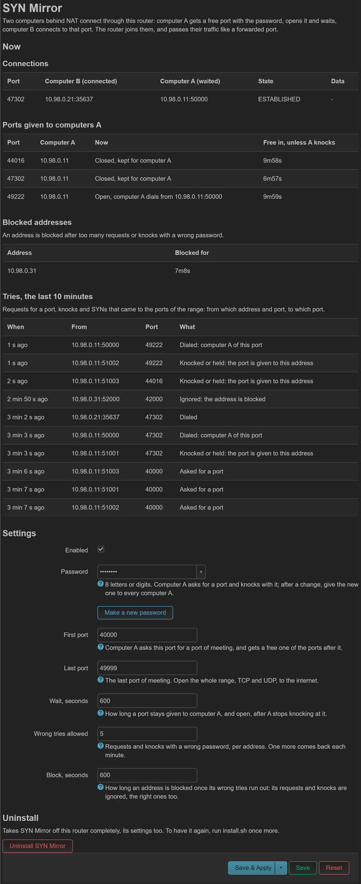

# SYN Mirror

Two computers at two homes cannot connect to each other directly: each sits behind a NAT, its home router, and a NAT lets
nothing in that its own computer did not ask for. SYN Mirror connects them through a **meeting point** both can reach: an
OpenWrt router or any Linux computer. The meeting point joins their two connections once, and from then on passes the traffic
the way a router passes a forwarded port: in the kernel, with no program in between.

What a relay server or a VPN does for two computers behind NAT, with the load of a forwarded port. Both computers only dial out,
as any program does; SYN Mirror makes their two dialings one connection. RemoteDesk takes it for its way ③.

**Nothing is copied.** A relay server receives every byte into a program and sends it again; a VPN encrypts and decrypts every
byte. SYN Mirror does neither: once the two connections meet, the meeting point does for them exactly what a router does for a
forwarded port - the kernel rewrites the addresses of each packet as it passes, and that is all. No program reads the data, no
buffer holds it, no byte goes up to a program and down again. So the meeting point costs what a forwarded port costs: a record
of a few hundred bytes per connection in the table of the kernel, and the forwarding a router does anyway, at its full speed. A
small home router that forwards ports well serves as many meetings as it would serve forwarded ports.

| | Needs a forwarded port at the home of the server | The traffic passes through a program | Load on the middle |
|:--|:--|:--|:--|
| Port forwarding | yes | no | none |
| A relay server (TURN and the like) | no | yes: every byte is received and sent again | high: CPU and memory for every byte |
| A VPN | no | yes: every byte is encrypted and decrypted | high: CPU for every byte |
| **SYN Mirror** | **no** | **no: the kernel forwards it, nothing copied** | **as for a forwarded port** |



| | The server | The client |
|:--|:--|:--|
| What it is | The computer with the service: RemoteDesk, Remote Desktop of Windows, SSH, a web server | The computer with the program that connects: the page of RemoteDesk, Remote Desktop Connection, ssh, a browser |
| What it does | Asks the meeting point for a port, opens it, and waits there | Connects to that port, as to any address |
| What it needs | The password of the meeting point; a few lines of code, or the script of SYN Mirror, or RemoteDesk | Only the line: the meeting point and the port. Nothing installed |

## What it does

- **Two NATs, no forwarded port.** The server waits behind its NAT, the client dials it from behind its own; they meet at a port
  of the meeting point, and get one TCP connection.
- **No program in the traffic, nothing copied.** After the meeting the kernel rewrites the addresses, as for a forwarded port:
  one record per connection, the data never read nor held by a program. The speed is the speed of the router forwarding, its
  load the load of a forwarded port: a weak router carries many connections at once.
- **Small.** A table of nftables rules, and one small script that answers the requests for a port: ucode on OpenWrt, about
  1.5 MB of memory, perl on a Linux computer.
- **Many at once.** As many servers wait at once as there are ports of meeting: 9999 by default.
- **A password, and guessers stopped.** 8 characters get and open a port; after 5 wrong tries an address is blocked for 10
  minutes, and a wrong one gets no answer at all.
- **Guessers of Remote Desktop and SSH stopped too.** A password tried and refused is a short connection: an address with more
  than 5 of them at a port is blocked there, in the kernel. A setting turns it off.
- **A page in LuCI.** The meeting point for the server in one line, copied with one button; who is connected, who waits, who is blocked, the tries of
  the last 10 minutes; the settings; Uninstall.
- **For any program.** Only the server needs a few lines for it; the client dials as it always does.

| Section | |
|:--|:--|
| [Quick start](#quick-start) | Install, the password, uninstall |
| [Words used here](#words-used-here) | NAT, the server and the client, meeting point, ports, knock, hold |
| [How it works](#how-it-works) | The meeting step by step, with pictures |
| [Install](#install) | On an OpenWrt router, on a Linux computer |
| [Update](#update) | The installer of the new release, the settings kept |
| [The page in LuCI](#the-page-in-luci) | What the page shows and does |
| [Settings](#settings) | Password, ports, times, the block of guessers |
| [Uninstall](#uninstall) | Everything erased, the settings too |
| [Any port of the server](#any-port-of-the-server) | Remote Desktop, SSH, VNC, a web server, any port: one script on the server, the program of that service on the client |
| [With RemoteDesk](#with-remotedesk), [In your own program](#in-your-own-program) | The server |
| [Safety](#safety), [When something goes wrong](#when-something-goes-wrong), [Limits](#limits) | |
| [Folders](#folders) | What is where; the pictures of this page |

## Quick start

The meeting point is either of two, with a public address or the range of ports forwarded to it:

| | An OpenWrt router | A Linux computer: Debian, Ubuntu, Fedora, Arch and others |
|:--|:--|:--|
| **1. Install** | Download the installer of one file into `/tmp` of the router and run it there: see [Install](#on-an-openwrt-router) | Download the installer of one file and run it with `sudo`: see [Install](#on-a-linux-computer-or-server) |
| **2. The password** | The installer prints it. Later: the web interface of the router, **Services > SYN Mirror**, with the settings and what happens now: who is connected, who waits, who is blocked | The installer prints it. Later: the file `/etc/syn-mirror.conf`, with the settings |
| **3. The server** | Gets one line with everything it needs: **Copy the meeting point** on the same page | Gets one line with everything it needs, put together by hand: see below |
| **4. Uninstall** | **Uninstall SYN Mirror** at the bottom of the same page | `sudo sh syn-mirror-linux.sh remove` |

The line is the password, `@`, the public address or a name in DNS, `:`, the port of requests: `Tr7kQ2xZ@203.0.113.7:40000`.
Nothing else is to be given or typed. In RemoteDesk it is pasted where the program asks for the meeting point, or given to
`rdp-host --meet`. On a Linux computer it is `<PASSWORD>@<its public address>:<FIRST>`, of `/etc/syn-mirror.conf`.

## Words used here

| Word | What it means | Example |
|:--|:--|:--|
| **NAT** | A device that hides the computers of a home behind one address. It lets in only answers to what they sent out | A home Wi-Fi router |
| **The server** | The computer with the service. It asks for a port of meeting, opens it, and waits there for the client | The remote computer of RemoteDesk; a computer with Remote Desktop or SSH |
| **The client** | The computer that connects to the port the server opened: it only dials | A browser with the page of RemoteDesk; Remote Desktop Connection |
| **Meeting point** | The router or computer with SYN Mirror, reachable by both | An OpenWrt router with a public address, or a rented Linux computer, a VPS |
| **Port of requests** | The first port of the range. The server asks it for a port of meeting | 40000 |
| **Port of meeting** | A port the meeting point gives the server, one nobody else holds; the server and the client both dial it | 41933 |
| **Id** | 8 random bytes the server picks for itself and sends after the password: the port of meeting is given to them, not to an address | 8 bytes |
| **Knock** | The UDP packet with the password and the id that opens a port of meeting | 16 bytes |
| **Hold** | The password, the id and one byte more: the port stays given to the server, closed | 17 bytes |

## How it works



1. **The server gets a port.** It sends the password and its id to the port of requests. The meeting point answers with a port of
   meeting nobody else holds, 2 bytes, and gives it to that id: from then on only knocks with it open the port, from whatever
   address they come. A NAT that gives the server another address, or another port for each packet, does not take the port from it.
   No answer means the request or the answer was lost, and the server asks again with the same id: it gets the same port. A wrong password
   gets no answer at all, and an address that sends wrong ones too often is blocked for a while.
2. **The server opens the port: it knocks.** One UDP packet with the password and its id, to its port of meeting. A rule of the meeting point checks
   both, and opens the port. A wrong password opens nothing, and nor does another id. A server that shows its port to a
   person and waits for a yes holds the port instead: the password, the id and one byte more keep it given to it and closed.
3. **The server waits, dialing.** It dials the port every second, always from the same local port. The meeting point drops these
   attempts without an answer, and notes where they come from.
4. **The client connects.** It dials the same port, as any program dials an address.
5. **The meeting point sends the attempt of the client on to the server,** with the addresses rewritten so that it comes from
   exactly the address the server is dialing.
6. **The server answers.** It was waiting for an answer from that address, and here it is. TCP is made for this case: two sides that dial
   each other at once get one connection ("simultaneous open").
7. **The connection is set up.** The port of meeting closes for anyone else. It stays given to the server: its next knock opens it for
   the next client.
8. **The data flows.** The meeting point rewrites the addresses of every packet in the kernel, exactly as for a forwarded port.

### Why the NAT of the server lets the connection in

A NAT lets a packet in only if it looks like an answer: it must come from the address the computer behind it sent to. The server
has been sending to the port of meeting all along, so its NAT expects answers from there. The meeting point gives the attempt of
the client exactly that address:


The NAT of the client needs no trick: the client itself dialed the meeting point, so whatever comes back from there is an answer.

### What it costs the meeting point

- **The meetings are a table of nftables rules in the kernel.** One small script, `give`, waits for the requests for a port:
  ucode on OpenWrt, about 1.5 MB of memory, perl on a Linux computer. It does not touch the traffic: it answers a request with a
  port, once per server, and sleeps otherwise. Only the right password reaches it, a few requests a second from an address
  at most.
- **While the server waits:** a few small records per port of meeting, and one dropped packet a second.
- **After the meeting:** one connection record, as for any forwarded connection. The CPU work is the work of forwarding.

## Install

### On an OpenWrt router

**On the router, download the installer into `/tmp` and run it:**

```sh
ssh root@192.168.1.1
wget -O /tmp/syn-mirror-openwrt.sh https://github.com/AdHoc-Protocol/SynMirror/releases/latest/download/syn-mirror-openwrt.sh
sh /tmp/syn-mirror-openwrt.sh
```

The installer is one file of about 42 KB: the script, with the files of the folder [`OpenWRT`](OpenWRT) in it as text, so it can
be read before it runs. Each file is written straight to its place, and at the end the installer erases itself from `/tmp`.

A router without the internet gets it from a computer: download `syn-mirror-openwrt.sh` from
[the last release](https://github.com/AdHoc-Protocol/SynMirror/releases/latest), copy it with `scp -O syn-mirror-openwrt.sh
root@192.168.1.1:/tmp/` or WinSCP, and run `sh /tmp/syn-mirror-openwrt.sh` there.

It prints the password and where the page is:

```text
the password of this router: Tr7kQ2xZ
LuCI: Services > SYN Mirror
SYN Mirror: requests for a port at 40000, ports of meeting 40001-49999
```

That is all. The server gets its line from that page: **Copy the meeting point**, `Tr7kQ2xZ@203.0.113.7:40000`, the password,
the public address of the router and the port of requests in one. The modules of ucode `give` needs are downloaded when the
router has none: `ucode-mod-socket`, 60 KiB, the sockets; `ucode-mod-math`, which the snapshots of OpenWrt do not have. nftables, fw4 and ucode are in OpenWrt already. Running the installer
again updates SYN Mirror and keeps its settings: see [Update](#update).

The folder `OpenWRT` copied into `/tmp` installs the same way: `sh /tmp/OpenWRT/install.sh`, and its files are erased at the end.

For builders of firmware, the folder is also a package of the OpenWrt SDK: put it into `package/syn-mirror` and run
`make package/syn-mirror/compile`; the page is the package `luci-app-syn-mirror` from `OpenWRT/luci`.

### On a Linux computer or server

Debian, Ubuntu, Fedora, Arch and others with systemd. Install nftables first (`apt install nftables`, `dnf install nftables`,
`pacman -S nftables`); perl is there already on Debian and Ubuntu, elsewhere `dnf install perl`, `pacman -S perl`. Then download
the installer and run it:

```sh
wget https://github.com/AdHoc-Protocol/SynMirror/releases/latest/download/syn-mirror-linux.sh
sudo sh syn-mirror-linux.sh
```

The installer is one file of about 21 KB: the script, with the files it installs in it as text, so it can be read before it runs.

It prints the password, as on the router, and installs the service `syn-mirror`, which loads the rules and starts `give` at every
start of the computer. It also turns on the forwarding of packets, and lets the meetings and the requests for a port through the
firewall of iptables when there is one: Docker and ufw block them otherwise. The server gets one line: the password, `@`, the
public address of the computer, `:`, the first port of `/etc/syn-mirror.conf`, such as `Tr7kQ2xZ@203.0.113.7:40000`. To remove,
with the settings:
`sudo sh syn-mirror-linux.sh remove`. The whole folder `SynMirror` installs the same way: `sudo sh Linux/install.sh`, and
`sudo sh Linux/install.sh remove`.

### On both

✓ The whole range, the port of requests too, must be reachable from the internet: TCP and UDP. Open it in the firewall of the
hosting provider, if it has one. If the router itself is behind the NAT of its provider, forward the range to it.
✗ Do not choose a range that other services of the meeting point use.

## Update

An update is the installer of the new release run over the installed SYN Mirror: the same commands as to install. The settings
stay, the password with them; nothing is to be removed first.

On an OpenWrt router:

```sh
wget -O /tmp/syn-mirror-openwrt.sh https://github.com/AdHoc-Protocol/SynMirror/releases/latest/download/syn-mirror-openwrt.sh
sh /tmp/syn-mirror-openwrt.sh
```

The installer prints no password: it has one already. Reload the page of LuCI afterwards, so that the browser takes its new
version.

On a Linux computer:

```sh
wget -O syn-mirror-linux.sh https://github.com/AdHoc-Protocol/SynMirror/releases/latest/download/syn-mirror-linux.sh
sudo sh syn-mirror-linux.sh
```

`-O` writes over the installer of the last time, which `wget` would keep beside the new one otherwise.

On both, the connections going on go on, and the ports given stay with their servers: the rules are loaded anew with them,
and `give` starts again with its new code. A Linux computer reloads the service `syn-mirror` for it, not restarts it: the stop of
a restart would take the rules away.

The releases, and what changed in each: [Releases](https://github.com/AdHoc-Protocol/SynMirror/releases).

## The page in LuCI

When the router has LuCI, its web interface, the installer adds the page **Services > SYN Mirror**. A Linux computer has no
page: its settings are a file, see [Settings](#settings).



**For the server** shows this router as the meeting point in one line, everything the server needs, the password hidden:
`********@203.0.113.7:40000` - the password, the public address of the router, the port of requests. **Copy the meeting point**
puts it into the clipboard with the password: it is pasted where RemoteDesk asks for the meeting point, or given to
`rdp-host --meet`.

The address is the public one of the router: that of its wan when it is public. When it is not - another router in front, or the
NAT of the provider - the router asks public servers of STUN at what address the internet sees it, and the page says to forward
the range to it there. A name in DNS, when you keep one, goes into the setting **DNS name**: the line has it then. The router
cannot know such a name, nor whether it is kept up to date: only you do.

**Now** is renewed every 5 seconds:

| Table | One row is | Columns |
|:--|:--|:--|
| Connections | Two computers that met | The port, the client, the server, the state of the connection, the data passed |
| Ports given to servers | A port given to a server | The port, the address the server knocks from, what the port does now, how long until it is free again unless the server knocks |
| Blocked addresses | An address that sent a wrong password too often, or guessed passwords at a port | The address; all ports, or the port it guessed at; how long until the block ends |
| Tries, the last 10 minutes | A request for a port or a knock that came to the range, or a SYN to a port given | When, from which address and port, to which port, what it was |

A port given is in one of three states: **closed, kept for the server** (it waits for a yes of its person and holds the port, or
has just met), **open, the server does not dial yet**, or **open, the server dials** (from its address and port). When the service gives no ports,
because `give` is not running, a warning above the tables says so.

**Tries** is for finding out why something does not work. It shows the newest 30, and how many there are in all:

| What | It means |
|:--|:--|
| Asked for a port | A request with the right password: `give` answered it |
| Knocked or held with the id the port is given to | A knock or a hold of the server |
| Knocked, but not with the id the port is given to | The server knocks with another id than it asked with, or its port was given away when it stopped knocking: it must ask again |
| Wrong password | A request or a knock with a wrong password: an old password, or someone guessing |
| Ignored: the address is blocked | Too many wrong ones came from this address |
| Dialed, ignored: it guessed passwords at this port | Too many short connections came from this address to this port: see Guard below |
| Dialed: the server of this port | A SYN of the server, from an address that knocked with its id |
| Dialed | A SYN of anyone else to a port given: the client, or someone who dials it while it is closed |

Each kind keeps up to 256 entries: a flood of wrong passwords does not push out the tries of the computers that work. A SYN to
a port nobody holds is not noted: the scanners of the internet dial every port of every address all day, and the client dials
only a port given.

**Settings**: everything of the next section. The password is hidden; the button beside it shows it. **Make a new password**
puts a random one into the field and shows it, to be copied. **Save & Apply** loads the settings at once: the connections going
on go on, the ports given stay with their servers, the blocks are lifted.

✓ After a new password, give it to every server at once.
✗ Otherwise a server keeps asking and knocking with the old one, and blocks its own address after 5 tries.

**Uninstall** at the bottom of the page: see [Uninstall](#uninstall).

## Settings

On a router with LuCI, all of them are on its page. Without it, or on a Linux computer:

| Setting | Default | What it is |
|:--|:--|:--|
| Password | made by the installer | 8 characters. Whoever knows it can get and open a port of meeting |
| First and last port | `40000`, `49999` | The range: the first port is the port of requests, the others are the ports of meeting |
| Wait | `60` | Seconds a port stays open, and given to its server, after the server stops knocking at it |
| Tries | `5` | Wrong knocks and requests an address may make. One more try comes back each minute |
| Block | `600` | Seconds an address is blocked after its tries run out: its knocks and requests are ignored, even with the right password. And seconds an address that guessed at a port is kept from that port |
| Guard | on | The guard against guessing passwords: off for a server whose connections are short by nature, a web server of many quick requests |
| Short | `20` | Seconds: a connection that the client ends within them is short, a password tried and refused |
| Guesses | `5` | Short connections an address may make to a port. One more comes back each 10 minutes; past them the address is blocked at that port |
| DNS name | empty | On a router only, optional: a name of the router in DNS, for the line the page copies for the server. Empty: the public address of the router |

On a router they are in `/etc/config/syn-mirror`:

```sh
uci set syn-mirror.main.first=20000
uci set syn-mirror.main.last=29999
uci set syn-mirror.main.block=300
uci set syn-mirror.main.guard=0
uci commit syn-mirror
/etc/init.d/syn-mirror reload
```

On a Linux computer, in `/etc/syn-mirror.conf`:

```sh
PASSWORD=Tr7kQ2xZ
FIRST=20000
LAST=29999
WAIT=60
TRIES=5
BLOCK=300
GUARD=1
SHORT=20
GUESSES=5
```

then `sudo systemctl reload syn-mirror`.

The server must use the same password, and the first port as the port it asks for a port of meeting: for RemoteDesk,
`Tr7kQ2xZ@router.example.org:20000`, as the page copies it.

### Guard against guessing

A port of meeting that leads to Remote Desktop of Windows or SSH is found by the programs of the internet that try every port
of every address, and they guess passwords there. Each guess is one connection: it opens, the password is refused, it closes, a
few kilobytes in a second or two. Someone who works stays minutes and hours. So the meeting point counts, in the kernel, the
connections that the client ends within **Short** seconds, per address and port of meeting:

| Short connections of one address to one port | What happens |
|:--|:--|
| Up to **Guesses**, 5; one more comes back each 10 minutes | Nothing: someone who mistyped the password, twice or three times, comes in as always |
| Past them | The address is blocked at that port for **Block** seconds: its SYNs to it go nowhere. Other ports of meeting stay open to it |

With a meeting at most each 15 seconds at a port, a guesser gets 5 tries, and then one in 10 minutes: some 150 a day, nothing
against a long password. It is no reason for a short one.

The guard is on by default. Turn it off - **Guard** on the page, `uci set syn-mirror.main.guard=0`, or `GUARD=0` - only for a
server whose connections are short by nature: a web server answering many quick requests, a program that connects for a moment
and goes. The page shows the addresses blocked at a port in **Blocked addresses**, the port beside them.

## Uninstall

Every way erases everything SYN Mirror installed: the rules, the service, the page in LuCI, the settings with the password.
Connections that met end at once. Nothing is left to clean by hand.

| Where | How |
|:--|:--|
| A router with LuCI | **Uninstall SYN Mirror** at the bottom of its page, then confirm. The page goes to the overview of the router |
| A router without LuCI | `/usr/libexec/syn-mirror/uninstall`: the installer put it there |
| A Linux computer | `sudo sh syn-mirror-linux.sh remove`, or `sudo sh Linux/install.sh remove` from the folder `SynMirror` |

Installed as packages of the SDK, the packages are removed as well. To have SYN Mirror again, install it once more: it starts
with a new password.

## Any port of the server

When the client needs a service of the server - Remote Desktop of Windows, SSH, VNC, a web server, any TCP port - and nothing
more, the server runs one script, and the client uses the program of that service, as with any address: Remote Desktop
Connection, ssh, a VNC viewer, a browser. Nothing is installed on the client. The script asks for a port of meeting, shows the line, and joins each one who comes to the
server: the bytes go as they are, both ways. The server checks who comes, as always.

| The server | Download | Start |
|:--|:--|:--|
| Windows | [`syn-mirror-server-windows.zip`](https://github.com/AdHoc-Protocol/SynMirror/releases/latest/download/syn-mirror-server-windows.zip): unpack it into a folder | A double click on `syn-mirror-server.cmd` |
| Linux, macOS | [`syn-mirror-server.pl`](https://github.com/AdHoc-Protocol/SynMirror/releases/latest/download/syn-mirror-server.pl) | `perl syn-mirror-server.pl` |

Windows PowerShell of Windows runs the one, the perl of the system the other: nothing else to install. The script asks what to
open, then the meeting point, as its owner gave it, the line of its page:

```text
 🔌 What should the other computer reach through the meeting point?

    1  🪟  Remote Desktop of Windows  port 3389 · Remote Desktop Connection ( mstsc ): a long, strong password on the account is a must
    2  🔐  SSH                        port 22 · ssh -p <port> <meeting point>
    3  🖼️  VNC                        port 5900 · a VNC viewer
    4  🌐  A web server               port 80 · a browser: http://<meeting point>:<port>
    5  ✏️  Another port               of this computer, or address:port of its network: you type which

 Press 1-5 › 1  🪟 Remote Desktop of Windows
 The meeting point, as its owner gave it, such as Tr7kQ2xZ@router.example.org:40000: Tr7kQ2xZ@router.example.org:40000
```

The answers are kept beside the script, `syn-mirror-server.settings`: next time Enter takes each. Then it shows the line for the client,
and puts it in the clipboard:

```text
 💤 To connect later, this computer must stay on and awake while this runs: asleep, it lets nobody in, and a minute later the meeting point gives its port to others
 🔌 127.0.0.1:3389 answers: whoever comes is joined to it

 📨 Send this line to whoever connects:
    ╭────────────────────────────╮
    │  router.example.org:41933  │
    ╰────────────────────────────╯
 📋 It is in your clipboard already: just paste it into a message
 🖥️ Remote Desktop Connection ( mstsc ) of the other computer: as the computer, router.example.org:41933

 👀 Waiting for whoever connects…
 ✅ Someone came: joined to 127.0.0.1:3389
```

From a console or a script, nothing asked:

```text
powershell -ExecutionPolicy Bypass -File syn-mirror-server.ps1 -Meet Tr7kQ2xZ@router.example.org:40000 -Forward 3389
perl syn-mirror-server.pl --meet Tr7kQ2xZ@router.example.org:40000 --forward 22
```

`-Forward`, `--forward`: a port of the server, or address:port of a computer of its network, such as `192.168.1.5:80`.

After each connection the script waits again at the same port: the client connects again with the same line, after a break
too, a second client as well. A new start of the script gets a new port, and so a new line.

✓ To connect later, the server stays on and awake, the script running: asleep, it stops knocking, and a minute later the
meeting point gives its port to others. Windows: **Settings > System > Power**, sleep **Never**. Linux: suspend never, or
`systemd-inhibit perl syn-mirror-server.pl`. The screen may go dark.
✓ For Remote Desktop of Windows: Windows Pro or above, Remote Desktop on, an account with a password. The script says at its
start when nothing answers at the port.
✗ The port of meeting is open the whole time the script waits, and the program of the client does not knock: whoever dials it reaches the
server, as with a port forwarded on a router. Expect guessing: programs of the internet try every port of every address, and on
one that answers as Remote Desktop or SSH they try names and passwords, thousands of them, day and night. The password of that
server is all that stops them:

- a long password of its own, 16 characters or more, or four or five random words, used nowhere else;
- no account named Administrator, admin, root or user to log in with: those are guessed first;
- for SSH, keys rather than passwords;
- the line kept private, and the script stopped when nobody needs it.

The meeting point slows the guessers down and blocks them, see [Guard against guessing](#guard-against-guessing): that is the
second line of defense, the password the first.

## With RemoteDesk

On the remote computer:

```text
rdp-host --meet Tr7kQ2xZ@router.example.org:40000
```

or press **3** in its window and paste the same line: the page of the router copies it.

It asks the meeting point for a port, prints a line such as `router.example.org:41933/K7QM2XHP9RTA4WZD8CNE-24NDRCK9` to send to
whoever connects, and waits for them at once, as long as it runs. The README of RemoteDesk shows the whole way, its way ③.

The same program makes SYN Mirror a relay to any TCP server of the remote computer, or of its network: Remote Desktop of Windows,
SSH, VNC. In its window **3**, then **2** for Remote Desktop or **3** for a port typed; from a console:

```text
rdp-host --meet Tr7kQ2xZ@router.example.org:40000 --forward 3389
```

Whoever connects then uses the program of that server: Remote Desktop Connection (`mstsc`) at `router.example.org:41933`, `ssh -p
41933 router.example.org`. Nothing to install on that side: the client only dials. The same warning holds as for the scripts: whoever
finds the port guesses passwords, a long one of its own is a must, see [Any port of the server](#any-port-of-the-server).

✓ To connect later, the remote computer stays on and awake: asleep, it stops knocking, and a minute later the meeting point gives
its port to others.

## In your own program

Only the server needs code for SYN Mirror; the client dials as usual. The server takes the one line its owner gives,
`password@meeting-point:first`: the password before the `@`, the port of requests after the last `:`. In pseudocode:

```text
udp = a UDP socket
id = 8 random bytes                              once: the port is given to them
repeat up to 10 times:                           the port of meeting
    udp.send(meeting-point:first, password + id) 16 bytes, nothing else
    if udp.receive within 1 s gets 2 bytes from meeting-point:first:
        port = those 2 bytes, high first; stop repeating
show "meeting-point:port" to the person who passes it to the client
until the person says yes, every second:         optional: the port stays given, and closed
    udp.send(meeting-point:port, password + id + 1 byte)
loop:
    udp.send(meeting-point:port, password + id)  the knock
    tcp = a TCP socket with SO_REUSEADDR, bound to the same local port each time
    if tcp.connect(meeting-point:port) succeeds within 1 s:
        the client has come: serve the connection
        to wait for the next client, go on with a new local port
    else wait what is left of the second
```

✓ Ask, hold and knock with one id. From one UDP socket too: the NAT of the server keeps one mapping for them.
✓ Dial from the same local port every time: the NAT of the server then keeps expecting answers at the same place.
✓ Knock before each try: it keeps the port open and given.
✗ Do not pause long between tries: the meeting point forgets the server 15 s after its last try, and gives its port away `wait` seconds
after its last knock.

## Safety

- The password only gets and opens a port of meeting. It does not let anyone into the server: the server decides who it talks to, as
  RemoteDesk does with its token.
- Guessing the password is cut short: after 5 wrong knocks or requests an address is blocked for 10 minutes (the settings Tries
  and Block). Wrong ones get no answer at all, so a guess is not even confirmed: the kernel drops it before `give` sees it.
- Guessing the passwords of the services of the server is cut short too: an address with more than 5 short connections to a port
  of meeting is blocked at that port, see [Guard against guessing](#guard-against-guessing).
- The answer of `give` is 2 bytes, shorter than the request: the meeting point cannot be used to multiply someone's traffic.
- Only what is sent to the meeting point itself counts as a knock. Computers of the router's LAN reach servers on these ports
  as before, and answers to the router's own requests, DNS among them, pass as before.
- The knock is not encrypted: someone who watches the traffic can learn the password and the id, and open ports. Change the
  password then; it gives them no access to the computers.
- SYN Mirror does not encrypt the traffic of the server and the client: they do it themselves. RemoteDesk does.

## When something goes wrong

| What happens | Why | What to do |
|:--|:--|:--|
| The client cannot connect at all | The port is closed: the server does not knock at it - it holds it, waiting for a yes of its person, or it is not running, or it sleeps -, or the client dials a port of an earlier start of the server | Let the server knock: for RemoteDesk, the program runs on the remote computer, and the computer does not sleep. Take the port the server shows now |
| The server gets no port | A wrong password, a wrong first port, `give` not running, or the address of the server is blocked | Check the password, and the port the server asks: the first of the range; on a router `logread -e syn-mirror`, on a Linux computer `systemctl status syn-mirror` |
| The server knocks with the right password, and still the port stays closed | The address of the server is blocked: someone at the same address knocked wrong too often, or the server used an old password. Or it knocks with another id than it asked with | Wait for the block to end (10 minutes by default); ask and knock with one id |
| The server gets no port, and its address is blocked after a few tries | SYN Mirror there is older than the ids: it takes the password and the id for a wrong password | Update SYN Mirror: see [Update](#update) |
| The server gets no port, nothing is blocked, **Tries** shows nothing of it | Its program is older than the ids: it sends the password alone, and the meeting point drops it | Update it: for RemoteDesk, its new release |
| Nothing reaches the meeting point | Its range is blocked: by the NAT of its provider, or the firewall of the hosting | Forward or open the range of ports |
| The client cannot connect right after a meeting on the same port | The meeting point remembers the server as it was for up to 15 s | The client tries again; RemoteDesk does it by itself |
| It worked, then stopped on a Linux computer | `nftables.service` was restarted or firewalld reloaded: they wipe the rules | `sudo systemctl restart syn-mirror` |
| The service does not start; the log says `the password must be 8 characters` | The password is not 8 characters | Fix it in the settings, then reload |
| No **SYN Mirror** under **Services** after installing | The browser shows the menu it loaded before | Reload the page, or log out of LuCI and in again |
| The column Data is always `-` | The router does not count bytes of connections: OpenWrt has it off by default | Turn it on for the whole router: `sysctl -w net.netfilter.nf_conntrack_acct=1` |

## Limits

- IPv4 only.
- The server must accept two connections meeting. Linux does, and Windows 11 with its firewall on: its firewall takes the SYN
  that comes for its own dialing socket as part of that connection. macOS is not tested yet.
- As many servers wait at once as there are ports of meeting: 9999 by default.
- The server may be in the LAN of the meeting point itself, and use the same line: it asks at the public address, and `give`
  answers from that address, not from the one of the LAN. On Linux, `give` learns the addresses of the computer at its start and
  at `systemctl reload syn-mirror`; one added later is answered from the address the kernel picks.
- The block is by address: computers that share one public address with someone who guesses passwords are blocked with them.
- The guard counts only the connections the client ends: the service of the server ending it first, the client ends it a moment later, and that is
  counted. Its byte count is not looked at: a connection of a few seconds that sent megabytes counts as short.

## Folders

| Folder | What is there |
|:--|:--|
| [`OpenWRT/`](OpenWRT) | For an OpenWrt router: the installer, the package, in `files/` the rules every meeting point uses, `give.uc` and the uninstaller, in `luci/` the page of LuCI |
| [`pack.sh`](pack.sh) | Makes the installers of one file: `sh pack.sh openwrt syn-mirror-openwrt.sh`, `sh pack.sh linux syn-mirror-linux.sh` |
| [`.github/`](.github) | A tag `v…` pushed: GitHub makes both installers of one file, installs them, on OpenWrt in Docker, the last release and the snapshot, on Ubuntu with systemd and on Debian without, and puts them into the release, with the scripts of `Server/` |
| [`Linux/`](Linux) | For a Linux computer: the installer, `give.pl`, the service of systemd, the settings |
| [`Server/`](Server) | The server without RemoteDesk: `syn-mirror-server.ps1` and the `.cmd` that starts it for Windows, `syn-mirror-server.pl` for Linux and macOS. See [Any port of the server](#any-port-of-the-server) |
| [`docs/`](docs) | The pictures of this page. They are drawn by hand by a script, in [`docs/draw/`](docs/draw): `npm install`, then `node draw.mjs` there draws them again |
